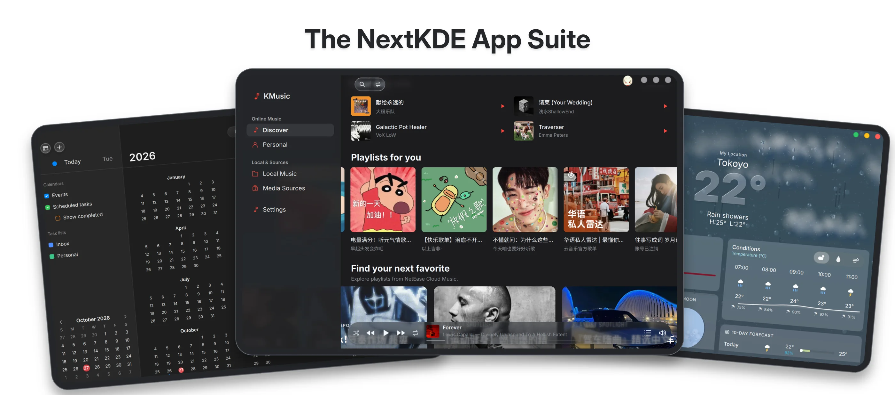

<p align="center">
  <picture>
    <source media="(prefers-color-scheme: dark)" srcset="docs/images/nextkde-logo-dark.svg">
    
  </picture>
</p>

<h1 align="center">NextKDE</h1>

<p align="center"><strong>Un escritorio Quickshell para KDE Plasma.</strong><br>
Vidrio líquido, un dock flotante y un espacio de trabajo a tu medida.</p>

<p align="center">
  <a href="#primeros-pasos">Primeros pasos</a> ·
  <a href="#el-escritorio">Explorar</a> ·
  <a href="docs/Development.md">Desarrollo</a>
</p>

<p align="center">
  <a href="README.md">English</a> ·
  <a href="README.zh-CN.md">简体中文</a> ·
  <a href="README.ja.md">日本語</a> ·
  <strong>Español</strong>
</p>

<p align="center"><code>Plasma 6 / Wayland</code> &nbsp; <code>Quickshell 0.3.x</code> &nbsp; <code>Qt 6</code></p>


<p align="center"><sub>El escritorio de NextKDE · apariencia macOS · ajustes de tema</sub></p>

La experiencia de escritorio de NextKDE se extiende a una familia creciente de
aplicaciones complementarias: Calendario, Clima, Calculadora y Tareas están
disponibles como aplicaciones opcionales, mientras que
[KMusic](https://github.com/NextKde/KMusic) añade la música. Correo y Gestor de
archivos están previstos para el futuro.



---

## El escritorio

El **KOS Desktop Shell** de NextKDE reúne la barra, el dock, el lanzador, la
búsqueda, las notificaciones y los ajustes en KDE Plasma 6 Wayland. Funciona con
KWin, NetworkManager, PipeWire, BlueZ y systemd.

| Un espacio de trabajo de un vistazo | Un escritorio en movimiento | Tu apariencia preferida |
| :--- | :--- | :--- |
| Reloj, clima, calendario, métricas del sistema, uso de aplicaciones y widgets multimedia. | Un dock flotante, vistas previas de ventanas, búsqueda de aplicaciones y un lanzador a pantalla completa. | Vidrio líquido, materiales de luz suave y esmerilados, o una interfaz Material Design tonal. |

- **Barra superior y menú del sistema** — menús de aplicaciones, estado del sistema y el menú del logotipo de NextKDE para ajustes y acciones de sesión.
- **Centro de control** — Wi-Fi, Bluetooth, volumen, brillo, capturas de pantalla y No molestar.
- **Archivos del escritorio** — abrir, renombrar, copiar, mover, eliminar y elegir una aplicación.
- **Ajustes y movimiento** — configura la barra, el dock, el lanzador, los atajos, la decoración de ventanas y las animaciones.

Calendario, Calculadora, Tareas y Clima están disponibles como
[aplicaciones independientes opcionales](apps/README.md). `./tools/kosctl install apps`
instala estas cuatro. ListenFree y su SDK de audio requieren
`./tools/kosctl install apps --with-listenfree` de forma explícita; consulta la
[guía de instalación de aplicaciones](docs/GettingStarted.md#optional-standalone-applications).

## Primeros pasos

Usa una sesión **KDE Plasma 6 Wayland** con **KWin 6.6+**, **Quickshell 0.3.x**
y **Qt 6.6+**. La instalación compila el servicio de plataforma, los Ajustes, los
efectos de KWin y la decoración de ventanas.

### 1. Preparar las dependencias

La selección del código fuente también requiere **Git** y **Python 3.9+**. Sigue
la guía de tu distribución antes de ejecutar los comandos de instalación:

| Distribución | Guía de instalación |
| :--- | :--- |
| Arch Linux | [Dependencias y configuración](docs/GettingStarted.md#1-install-requirements) |
| Debian 13 | [Instalador y configuración manual](docs/GettingStarted.md#debian-13-trixie) |
| Ubuntu 26.04 | [Paquetes y configuración](docs/GettingStarted.md#ubuntu-2604-resolute) |
| Fedora 44 | [Paquetes y configuración](docs/GettingStarted.md#fedora-44-community-contributed) |
| openSUSE Tumbleweed | [Paquetes zypper y configuración](docs/GettingStarted.md#opensuse-tumbleweed-community-contributed) |
| NixOS | [Inicio rápido con Flake](docs/nixos-quickstart.md) |

### 2. Elegir una versión e instalar

Para NixOS, sigue la guía de Flake anterior. Para las demás distribuciones, una
vez preparadas las dependencias:

```sh
git clone --depth 1 https://github.com/SuceV587/NextKde.git
cd NextKde
./tools/kosctl update &&
./tools/kosctl doctor &&
./tools/kosctl install &&
./tools/kosctl start
```

`update` selecciona el código fuente, `doctor` comprueba las dependencias,
`install` despliega el escritorio y `start` inicia o reinicia sus servicios.
Seleccionar solo el código fuente no instala ni reinicia el escritorio.

### Selección de versión

De forma predeterminada, `update` selecciona la
[última versión oficial](https://github.com/SuceV587/NextKde/releases/latest) y
se detiene si no hay ninguna. Solo se mantiene la última versión oficial;
consulta la [política de versiones](docs/Releasing.md).

Para probar la rama de desarrollo, usa `./tools/kosctl update main`
(o `--version main` con el instalador de Debian). `./tools/kosctl version`
muestra por separado los archivos instalados y el código fuente.

Lee la [guía de instalación](docs/GettingStarted.md) para la toma de control del
escritorio, la configuración opcional de la pantalla de bloqueo, las notas del
primer inicio de sesión, la actualización y la desinstalación.

<details>
<summary><strong>Comandos de uso diario</strong></summary>

Actualizar y aplicar:

```sh
./tools/kosctl update &&
./tools/kosctl install &&
./tools/kosctl start
```

Comprobar los servicios:

```sh
systemctl --user status kos-platform.service kos-data.service kos-shell.service
```

Desinstalar:

```sh
./tools/kosctl uninstall
```

Los binarios actualizados de los efectos de KWin se cargan tras cerrar y volver
a iniciar sesión, o tras reiniciar. Consulta la
[guía de uso diario](docs/GettingStarted.md#daily-use) para más detalles.

</details>

Consulta el [índice de documentación](docs/README.md) para las guías canónicas y
las referencias para colaboradores con IA.

## Bajo la superficie

```text
Quickshell Shell ──► kos-platform ──────► KWin / network / audio / Bluetooth
                 └─► kos-data-service ─► metrics / desktop data / weather
```

| Explora el proyecto | Guía |
| :--- | :--- |
| Cómo encajan las piezas | [Arquitectura del proyecto](docs/ProjectArchitecture.md) |
| Vidrio, color y apariencia | [Arquitectura de apariencia](docs/AppearanceArchitecture.md) |
| Comportamiento y configuración del dock | [Arquitectura del dock](docs/DockArchitecture.md) |
| Disposición de los iconos del escritorio | [Iconos del escritorio](docs/DesktopIcons.md) |
| Fondos de pantalla espaciales | [Motor de profundidad](docs/DepthEngine.md) |
| Sesiones de código fuente, compilación y depuración | [Guía de desarrollo](docs/Development.md) |
| Cambios y pull requests | [Contribuir](CONTRIBUTING.md) |

Los próximos pasos incluyen diseños por pantalla, widgets coherentes en todas las
pantallas, ajustes y aplicaciones ampliados, y una mejor navegación por teclado y
accesibilidad.

---

## Colaboradores

¡Gracias a todas las personas que contribuyen a NextKDE!

<a href="https://github.com/NextKde/NextKde/graphs/contributors">
  
</a>

Generado automáticamente a partir de las contribuciones de GitHub con [contrib.rocks](https://contrib.rocks).

## Licencia

Consulta [LICENSE](LICENSE) para la licencia del proyecto. El efecto Glass
incluido tiene su propia [licencia](kwin/glass-effect/LICENSE).
