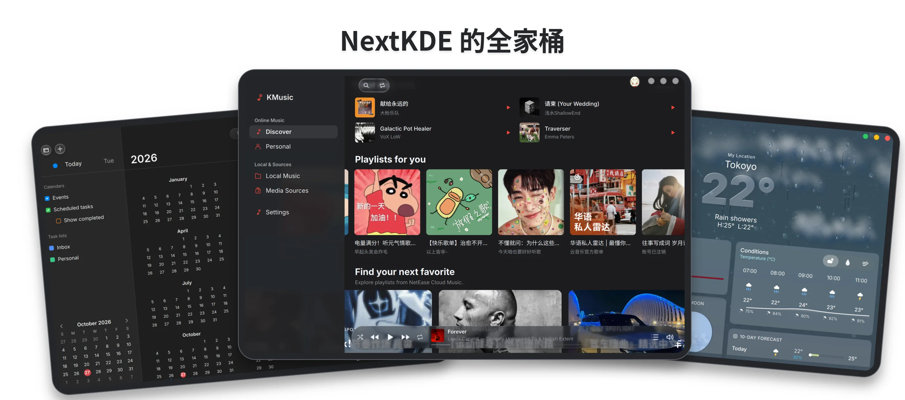

# NextKDE

[English](README.md) · **简体中文** · [日本語](README.ja.md) · [Español](README.es.md)

[文档索引](docs/README.zh-CN.md)

基于 Quickshell 的 KDE Plasma 桌面，包含顶栏、浮动 Dock、启动器、搜索、通知、设置、桌面文件及组件。
支持液态玻璃、柔光/磨砂、Material 外观，接入 KWin、NetworkManager、PipeWire、BlueZ、systemd。


NextKDE 的桌面体验也延伸到一套持续完善的配套应用：日历、天气、计算器和待办可按需安装，
[KMusic](https://github.com/NextKde/KMusic) 则带来音乐体验。邮件和文件管理器也在后续规划中。



## 开始使用

使用 Plasma 6 Wayland、KWin 6.6+、Quickshell 0.3.x、Qt 6.6+ 和匹配开发依赖。

### 1. 准备依赖

选择源码还需要 **Git** 和 **Python 3.9+**。先按[安装指南](docs/GettingStarted.zh-CN.md)
准备对应发行版的依赖；实测范围以发布说明为准。
NixOS 请使用[声明式安装指南](docs/nixos-quickstart.zh-CN.md)。

### 2. 选择正式版并安装

除 NixOS 外，其他发行版准备好依赖后，运行：

```sh
git clone --depth 1 https://github.com/SuceV587/NextKde.git
cd NextKde
./tools/kosctl update &&
./tools/kosctl doctor &&
./tools/kosctl install &&
./tools/kosctl start
```

`update` 选择源码，`doctor` 检查依赖，`install` 部署桌面，`start` 启动或重启服务。
仅选择源码不会安装或重启桌面。

### 版本选择

`update` 默认选择[最新正式版](https://github.com/SuceV587/NextKde/releases/latest)，没有正式版时会停止。
项目只维护最新正式版，详见[发布策略](docs/Releasing.zh-CN.md)。

如需体验开发分支，使用 `./tools/kosctl update main`（Debian 安装器使用 `--version main`）。
`./tools/kosctl version` 分别显示已安装文件和源码的版本。KWin 更新后需注销登录或重启。

### 可选应用与后续设置

独立应用另装：`./tools/kosctl install apps` 默认仅日历、计算器、待办、天气。
ListenFree 及音频 SDK 需显式 `./tools/kosctl install apps --with-listenfree`。
核心 Settings 属于核心安装。锁屏可选；安装、桌面接管、更新、备份/回退、卸载及各发行版依赖统一见安装指南。

## 项目与开发

Shell 负责呈现，C++ `kos-platform` 负责桌面接入，Go `kos-data-service` 负责指标/历史/共享天气。
日历/待办共享按需 PIM，独立应用不导入 Shell 模块。
[项目架构](docs/ProjectArchitecture.md)、[外观](docs/AppearanceArchitecture.zh-CN.md)、
[Dock](docs/DockArchitecture.md)、[桌面图标](docs/DesktopIcons.zh-CN.md)、[深度引擎](docs/DepthEngine.md)。

开发和架构文档面向 AI 贡献者，见[项目上下文](PROJECT_CONTEXT.zh-CN.md)、
[开发指南](docs/Development.zh-CN.md)、[贡献规范](CONTRIBUTING.zh-CN.md)、[发布流程](docs/Releasing.zh-CN.md)。
所有项目构建/测试/图形验证只在 VM/托管 CI 执行，不在维护者本机。

后续方向包括分屏布局、多屏组件、设置和应用扩展、键盘导航及无障碍改进；不代表当前已实现。

## 贡献者

感谢每一位为 NextKDE 作出贡献的朋友！

<a href="https://github.com/NextKde/NextKde/graphs/contributors">
  
</a>

由 [contrib.rocks](https://contrib.rocks) 根据 GitHub 提交贡献记录自动生成。

## 许可

见 [LICENSE](LICENSE)，Glass 特效另有[许可](kwin/glass-effect/LICENSE)。
