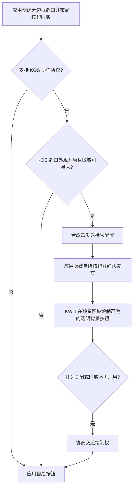

# 应用协作式窗口按钮

[English](CooperativeWindowControls.md)

天气、日历、kos-settings 等自有 Qt Quick 应用可让 KOS Bridge 在应用预留的位置绘制三色按钮，无需使用 KOS 窗口装饰器。窗口保留自己的内容、标题栏和背景；Bridge 只绘制应用声明的按钮：绿色最大化/还原、黄色最小化、红色关闭，可为零到三个。

## 决策与回退



使用 kos-settings 的 **KOS 窗口外观** 总开关以及同一套“按钮图标始终显示/悬停显示”偏好，没有另一个应用开关。声明过协作区域的窗口在回退期间也不使用旧浮层，避免重复按钮。未接入协议的第三方应用继续使用原有路径，GTK 原生适配见 [GTK 窗口按钮](GtkWindowButtons.zh-CN.md)。

## Qt Quick 接入

应用需要 Wayland、更新后的 `Kos.SurfaceShape` 模块和 KOS Bridge。共享控件会自动处理协商：

```qml
import QtQuick
import Kos.Ui

KosWindowControls {
    targetWindow: root
    maximizeMode: true
    actions: ["maximize", "minimize", "close"]
    circleSize: 14
    buttonWidth: 22
    buttonHeight: 22
    spacing: 6
    anchors.top: parent.top
    anchors.right: parent.right
    anchors.topMargin: 10
    anchors.rightMargin: 14
}
```

窗口应使用客户端自绘/无边框方式。控件位置由应用布局决定，无需 app ID 白名单或固定屏幕坐标。天气已有共享控件，日历也使用该控件。`compositorIntegration: false` 可要求该控件保持自绘；包含绿色按钮且 `maximizeMode: false` 时保留全屏自绘。

`actions: ["close"]` 只显示关闭按钮，`actions: []` 不显示按钮，也不保留旧点击区域。可以重排列表，动作通过名称识别。`buttonLayout` 提供实际圆点的局部矩形，布局事件只在数据变化后上报；数量不固定，不猜右上角位置。

原生模块通过可选 Loader 加载：模块缺失、X11、其他桌面或协议不可用时，应用仍可使用原来的按钮。模块缺失可能产生 Loader 导入警告，但不会阻止应用根组件加载。

## 协议与边界

协议源为 `shell/native/surface-shape/kos-window-controls-v1.xml`。每个 `wl_surface` 单独声明区域，不按应用进程或标题猜测。协议版本 2 通过 `set_buttons` 原子替换完整列表，每项包含动作及矩形。区域使用 surface 的逻辑坐标，布局、可见性、窗口状态变化触发更新；没有标题栏轮询、像素读回或背景颜色采样。仍需正常响应重绘和鼠标输入。

应用收到 configure 后切换自绘状态、确认序号，并提交下一帧；KWin 在对应 surface commit 上切换绘制权。位置和大小也随提交更新。透明间隙交给应用处理，实际存在的按钮由 KWin 响应。协作模式不启用旧浮层的右键位置调整或 Alt 平铺菜单。

当前支持普通窗口和对话框、等比且轴向对齐的区域。全屏、半透明控件、旋转/非等比缩放、区域越界或服务不可用时回到应用自绘。协议版本 2 每个 surface 只接受一个适配器和完整列表，支持零到三个唯一动作、直径 6–40 的正方形圆点、任意顺序和独立位置，整体包围区域最多 4096×4096 逻辑像素。重叠、重复动作、未知动作和越界布局拒绝整份列表。服务器仍兼容版本 1 的三按钮区域；新客户端连接旧服务器时自绘。其他工具包可按同一协议实现适配器；普通第三方应用不会因此自动拥有协作能力。

非 Row 布局可在应用平台层使用 `WindowControlSlot { target: header; buttons: layout }`，其中 `layout` 是 `[{action: "close", x: 300, y: 12, width: 14, height: 14}]` 这样的列表，坐标相对 target。把同一窗口所有分组的按钮合并到这一份列表，不要为每组创建一个适配器。应用必须绑定 `active` 到自绘隐藏状态并保留回退，不能只声明区域后永久隐藏按钮。

nextkdeAppDemo 的可移植规范由其 `docs/WindowControls.zh-CN.md` 维护。其 `KosWindowControls` 提供 `actions`、`buttonLayout`、`externalDrawing` 和 `hoverGlyphs`，不包含 Wayland 依赖；接入代码留在应用适配层。

## 验证

只在虚拟机运行构建、测试和图形会话。`tests/cooperative-controls/run-vm.py` 启动独立嵌套 KWin，使用 Breeze 验证无需 KOS 装饰器，并检查两个窗口的独立布局、动态布局、总开关、全屏和透明度回退，以及无背景/无取色缓存。可用 `--outer-x11` 向测试嵌套窗口发送 X11 按钮事件以验证动作。参数和环境示例见 [测试说明](../tests/cooperative-controls/README.md)。

旧浮层配置中的 `showButtons: false` 不会拒绝应用显式声明的协作按钮；是否接管由共用总开关和协议协商决定。

部署时须同时更新系统与 Shell 配置中的 `Kos/SurfaceShape` 模块。若启动环境的
`QML2_IMPORT_PATH` 指向 `~/.config/quickshell/kos`，该目录的模块会优先于系统版本。
日志中的 `WindowControlSlot is not a type` 表示加载到了不含协作类型的旧模块，应用会回退自绘。
更新这份模块后重新打开应用即可；只更新 `/usr` 的副本不能解决路径遮蔽。
