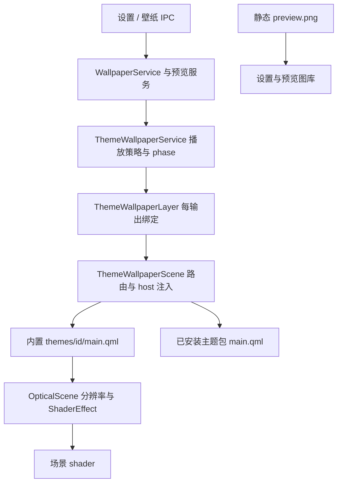

# 动态壁纸：设计思路与扩展指南

本文记录壁纸系列的视觉目标、技术取舍、现有实现和后续扩展方法。供维护者和后续 AI 开发任务使用。

**状态基线：2026-11-13。当前是已接入、shader 已编译的候选实现，尚未完成新版本的 VM 画面与性能验收。** 文中的“未来方向”不代表已经实现。旧系列的截图和资源数据不能用于证明新系列的效果。

相关文档：[运行架构](WallpaperArchitecture.zh-CN.md)、[主题包契约](ThemePackFormat.zh-CN.md)、[素材与预览状态](../shared/qml/wallpapers/assets/thumbnail-sources.txt)。

## 1. 目标与上一版的教训

目标是让壁纸本身具有成熟图形作品的质感，同时适合长时间作为桌面背景。允许复杂的物理光学，也允许极简构图；评判依据是实际画面和动态体验，不是算法数量或主题数量。

上一版采用程序生成的山脉、云团、植被底图，再覆盖低分辨率光效。用户明确否定了它的质量。具体问题是：

- 底图形体与材质不可信，程序重复痕迹明显。
- 动态亮纹与画面中的表面没有共同的几何依据，光和物体各动各的。
- 优先追求轻量、快速凑齐五款，缺少先做出一个完整标杆的过程。
- 编译、安装和截图完成，被混同为视觉完成。

烘焙本身不是问题。高质量模型、材质和照明可以烘焙成优秀资产；低质量底图不会因为叠加动态而变好。今后应先证明画面成立，再优化成本，再展开系列。

“虚幻引擎级质感”在这里是视觉目标，不是已经采用 Unreal Engine 的声明。现有实现是 Qt Quick + GLSL，含物理启发和受限近似，不是通用路径追踪。

## 2. 从社区学习什么

| 参考 | 值得保留的核心关系 | 使用边界 |
| --- | --- | --- |
| [Evan Wallace · WebGL Water](https://www.madebyevan.com/webgl-water/) / [源码](https://github.com/evanw/webgl-water) | 同一水面高度场生成法线，法线共同决定反射、折射和焦散 | 代码声明 MIT；贴图等素材须分别核对许可。高度场波动不等于完整流体求解 |
| [David Li · Waves](https://github.com/dli/waves) / [演示](https://david.li/waves/) | 风浪频谱、位移、法线和视角相关反光组成连续海面 | MIT。FFT 需要多次渲染及中间纹理，不能拿 demo 效果推断桌面成本 |
| [Pavel Dobryakov · Fluid](https://github.com/PavelDoGreat/WebGL-Fluid-Simulation) / [演示](https://paveldogreat.github.io/WebGL-Fluid-Simulation/) | 速度、压力、染料平流产生连续卷曲和细丝 | MIT。原作没有完整的桌面休眠策略；移植须补资源生命周期 |
| [pmndrs / N8Programs · Caustics](https://discourse.threejs.org/t/beautiful-caustics-for-threejs-open-source-contains-code-and-components/46819) | 厚度、环境照明、透射与地面焦散共同建立玻璃质感 | 各仓库及资产分别核对许可；[N8python/caustics](https://github.com/N8python/caustics) 标示 CC0 |
| [Bruno Simon · My Room in 3D](https://github.com/brunosimon/my-room-in-3d) | 研究高质量烘焙照明与运行时交互的组合 | 本轮未确认仓库许可，不直接搬用其源码或资产 |

当前四个 shader 是原创实现，使用通用光学、波动和程序噪声方法，**没有直接移植上述项目的完整引擎**。例如海面当前采用方向波叠加，不是 David Li 的 FFT；浅水也不是 Evan Wallace 的双缓冲波动模拟。

玻璃 shader 的色调映射使用 Krzysztof Narkowicz 的 [ACES Filmic Tone Mapping Curve](https://knarkowicz.wordpress.com/2016/01/06/aces-filmic-tone-mapping-curve/)，文件头保留来源及作者提供的 CC0 许可选项。

以后引入社区代码，应保存原作者、仓库、具体版本、许可文本和修改说明。代码、贴图、HDR 环境、模型、字体的许可分别确认。网上能看到的效果，不等于其代码和资产可以分发。

## 3. 当前系列与实现边界

持久化 ID 为兼容已有配置暂时保留，显示名称已改变：

| ID | 显示名称 | Shader | variant | 核心机制 |
| --- | --- | --- | ---: | --- |
| `starfield` | 极地流光 | `aurora.frag` | 0 | 有界体积积分、近远帷幕、随高度变化的发光与星空 |
| `blackhole` | 光学晶体 | `prism.frag` | 0 | 椭球射线求交、入射/出射折射、色散、内部反射和面光 |
| `weather` | 日落之海 | `ocean.frag` | 0 | 方向波、波面求交、解析法线、菲涅耳与金色天光 |
| `underwater` | 澄澈浅湾 | `lagoon.frag` | 0 | 水底折射、吸收、波场相关焦散与浅水材质 |
| `forest` | 月光之海 | `ocean.frag` | 1 | 与日落海面共用几何，改为钴蓝环境及银色月光 |

重要边界：

- `weather` 只是兼容 ID；新海面不消费实时天气。宿主仍可向其他主题提供天气属性。
- 海面是有界近似求交与方向波叠加，没有三维流体体积，也没有 FFT 状态纹理。
- 浅水焦散由同一波场的折射映射导数估算，是受限聚光近似，不是完整光子累积。
- 玻璃有真实光学关系的解析计算，但地面焦散和软阴影包含艺术近似，没有完整多物体全局照明。
- 极光采用 40 步积分；有体积层次，但不是大气物理研究级模拟。
- 四个 shader 当前不需要外部纹理。它们的画质与性能均不能由“单 shader”这个名称推断。
- `pointer` 已进入统一输入布局，但当前 shader 未使用它；鼠标互动不属于已交付功能。

已有变体可供后续选用：`prism` 的 0/1/2/3 分别为冰蓝、玫瑰、琥珀、较圆的透明晶体；`aurora` 的 0/1/2 分别偏翡翠、冷青紫、浅绿；`lagoon` 的 1 调整吸收。现有界面没有通用 variant 编辑器，变体由主题入口写定。

## 4. 运行架构与职责



| 文件 | 应承担的责任 |
| --- | --- |
| `shared/qml/foundation/WallpaperCatalog.js` | 内置主题 ID、名称、说明、accent 元数据 |
| `shell/desktop/modules/wallpaper/ThemeWallpaperService.qml` | 共享时钟、空闲与锁屏策略、电池状态、交互输入 |
| `shell/desktop/modules/wallpaper/ThemeWallpaperLayer.qml` | 每个输出的尺寸、phase、host 属性和就绪转发 |
| `shared/qml/wallpapers/ThemeWallpaperScene.qml` | 主题包优先解析、内置路由、Loader、host 注入 |
| `shared/qml/wallpapers/OpticalScene.qml` | 共享 ShaderEffect 包装、纹理尺寸限制、禁止前景加载 |
| `shared/qml/wallpapers/themes/<id>/main.qml` | 选择 shader 和变体，保持短小 |
| `shared/qml/wallpapers/shaders/` | 场景的几何、光学、材质、色调映射 |
| `shared/qml/wallpapers/ThemeWallpaperThumbnail.qml` | 静态缩略图路径与显示，不能启动实时场景 |

新的光学效果放进场景文件，不要把主题专用的色彩、波浪或玻璃逻辑塞进全局服务。只有需要新增输入或生命周期能力时，才修改共享契约。

主题包可以自行实现根场景，不必使用 `OpticalScene`。内置主题共用父目录组件，因此单独复制某个内置主题文件夹还不是可独立分发的包。

## 5. 时钟、尺寸与首帧契约

### 时钟由宿主管理

普通桌面在没有可见窗口后等待约 10 秒才播放。普通模式减少动态、锁屏、输出不可用等条件会停止时钟。预览有独立分支：立即播放，当前也绕过普通模式的减少动态限制，但仍受锁屏、输出与电池节奏影响。

目前普通节奏为 67ms，电池模式为 125ms，约对应每秒 15/8 次 phase 更新，**不是实测 FPS**。`phase` 按截断后的真实时间增量乘 0.5 推进；暂停后不补算整段时间。当前 shader 在主要运动公式中使用 `time * 2.0` 补偿。

新增主题不要另起 `Timer`、`NumberAnimation` 或浏览器循环绕开宿主。状态模拟需要额外固定步长和双缓冲时，必须让模拟调度也服从宿主暂停；只冻结显示时钟、后台继续计算不算暂停。

`themeAnimated`、`themeSpeed` 等旧配置字段不等同于当前有效策略。判断播放状态应以服务的 `running`、`cadence`、`phase` 为准。

### 渲染尺寸和坐标

`OpticalScene.resolutionLimit` 默认 1280；`host.economical` 为 true 时使用 800。场景按输出宽高比缩放并限制纹理长边，默认不超过逻辑窗口尺寸。当前宿主的 economical 来自电池状态。

`viewport` 仍是逻辑窗口大小。shader 使用 `qt_TexCoord0` 和宽高比构建射线，不要用 `gl_FragCoord / viewport` 假定缓冲等于窗口尺寸。4K 屏上这套默认设置仍是缩放后的图像，不是原生 4K 渲染。

这些限制仅约束该场景的离屏纹理。Qt、窗口合成、多显示器和其他资源还有成本；不能用纹理尺寸推断总显存。复杂 shader 也可能在低分辨率下消耗较高 GPU 时间。

`pointer.xy` 是归一化屏幕坐标，`.z` 表示指针是否在内；未激活时坐标可能远超出 `[0,1]`。交互实现先检查 `.z`，再使用坐标。

### host 和 frameReady

`ThemeWallpaperScene` 在 Loader 完成后才执行 `item.host = root`。根组件应声明 `property var host: null` 与 `signal frameReady()`，并容忍 host 尚未注入。

phase=0 必须能显示完整画面。`frameReady` 应异步发送，不能在完成回调中同步发出而早于宿主信号连接。当前 `OpticalScene` 使用 `Qt.callLater(root.frameReady)`，这是初始化通知，**还不是“GPU 已呈现有效首帧”的严格证明**。以后引入异步模型、纹理或多 pass 初始化，需要完善就绪条件，并处理失败状态。

另有待核实事项：同一主题反复进入预览或应用时，Loader 可能复用，导致没有新就绪信号。这是代码审阅发现的可能路径，尚未复现，不应当作已确认故障或已修复项目。

## 6. GLSL / QML 输入布局

当前四款 shader 共用以下布局：

```glsl
#version 440
layout(location = 0) in vec2 qt_TexCoord0;
layout(location = 0) out vec4 fragColor;
layout(std140, binding = 0) uniform buf {
    mat4 qt_Matrix;
    float qt_Opacity;
    vec2 viewport;
    float time;
    float variant;
    vec4 pointer;
};
```

对应 ShaderEffect 属性为 `vector2d viewport`、`real time`、`real variant`、`vector4d pointer`。保留匿名 uniform block；不自行加实例名后改变变量访问方式。std140 中 viewport 位于偏移 72、time 80、variant 84、pointer 96，完整块为 112 字节。

宿主还提供 `clickPulse`、`widgetRects`、`particleCount` 和天气等属性，但当前 `OpticalScene` 没有把它们传入 GLSL。需要点击涟漪、组件避让或天气驱动时，应先扩展包装层与 shader 输入，不能直接在 shader 中读取这些 host 字段。

当前包装使用 `blending: false`，各 shader 输出不透明场景并乘 `qt_Opacity`。如果以后需要透明叠加，应单独确定预乘 alpha、混合开关和前景生命周期，不能直接沿用这个不透明契约。

新增共享输入时，同时修改 QML 属性、所有使用该布局的 shader 及 `.qsb`。不要只修改其中一端；编译通过也不保证运行时属性正确绑定。

修改 shader 后，从仓库根执行编译命令：

```sh
glslangValidator shared/qml/wallpapers/shaders/your_scene.frag
sh shared/qml/wallpapers/compile.sh
```

脚本使用 `qsb --qsbversion 64 --qt6`，可通过 `QSB` 指定工具位置。源文件 `x.frag` 对应 `x.frag.qsb`，运行时读取后者。编译检查不是视觉验收；不要启动自动化 UI、headless 渲染或像素差分作为替代。

## 7. 怎样扩展

### A. 调整已有主题的艺术方向

适合改变光色、曝光、材质吸收、镜头位置、波浪尺度或极光配色。

1. 在对应 shader 中改参数，保留几何—法线—照明之间的联系。
2. 需要同时保留两种外观时，新增明确的 variant 分支；不要复制整份 shader 只改颜色。
3. 在 `themes/<id>/main.qml` 写定 variant，更新文案、accent 和预览图。
4. 手动观察不同时间的完整画面、切换和暂停恢复。

现有入口示例：

```qml
import QtQuick
import "../../" as Collection

Collection.OpticalScene {
    shader: Qt.resolvedUrl("../../shaders/ocean.frag.qsb")
    variant: 1
}
```

variant 是当前主题选择的实现细节；不是已有的持久化用户配置。若要增加可调整颜色、风速、材质等界面，需要另做参数 schema、存储、预览草稿和迁移，不能仅加一个 slider 就声称完整支持。

### B. 新增一个内置主题

例如新增 ID `tidal-glass`：

1. 建立 `shared/qml/wallpapers/themes/tidal-glass/main.qml` 和 `assets/preview.png`。
2. 能复用现有光学就引用已有 shader；否则添加新 `.frag` 和编译后的 `.qsb`。每主题独有 shader 也可放在该主题的 `shaders/`，编译脚本会扫描。
3. 在 `WallpaperCatalog.js` 的 `themes` 数组登记 ID、名称、说明、accent。
4. 在 `ThemeWallpaperScene.sceneUrl()` 增加显式路由；否则未知 ID 会落到 starfield 场景。
5. 在 `ThemeWallpaperThumbnail.qml` 增加缩略图映射；否则仍显示 starfield 的预览。
6. 为新增文案补齐 `ZhCatalog.mjs`、`PtBrCatalog.mjs` 等项目使用的翻译。
7. 更新素材来源、算法近似、手动验收记录，按项目部署入口发布资源。

只有新增可注册的共享 QML 类型才需要补 `wallpapers/qmldir`；主题内部的 `main.qml` 不需要为每个 ID 注册新类型。

`SettingsBridge::chooseWallpaperTheme()` 对五个旧 ID 之外的输入接受 `^[A-Za-z0-9_-]+$`。**当前新增合法 ID 不必为了选择功能修改 C++ 白名单**；存在性还需由 shell 的目录/包注册判断。不要被函数开头的五个 ID 分支误导。

ID 会持久化，新主题应使用稳定、有意义的 ID。当前旧 ID 与新画面的对应是历史兼容，不建议将“反复复用不相干 ID”作为扩展模式。

### C. 做独立主题包

适合实验主题或独立分发，无需把每个作品加入内置目录。

```text
tidal-glass/
├── manifest.json
├── main.qml
├── OpticalScene.qml       # 如复用，应随包携带所需版本及许可
├── preview.png
└── shaders/
    └── tidal_glass.frag.qsb
```

```json
{
  "id": "tidal-glass",
  "name": "潮汐玻璃",
  "detail": "折射光线与缓慢变化的浅水表面",
  "accent": "#6BAAB8",
  "version": 1,
  "entry": "main.qml",
  "preview": "preview.png"
}
```

默认安装根目录为 `~/.local/share/kos/wallpaper-themes/`，可用 `KOS_WALLPAPER_PACKS` 覆盖；服务约每 30 秒重扫。`entry` 和 `preview` 是包根目录文件名，不接受 `/` 或 `..`。入口内部可以用相对路径访问子目录资源。

包必须自包含，不导入 shell 私有模块；通过 host 取输入。同 ID 已安装包优先于内置路由，因此通常选择新 ID，避免无意覆盖内置主题。包 QML 可执行代码，不是沙箱插件市场。

详细规则以[主题包契约](ThemePackFormat.zh-CN.md)及对应解析代码为准。

## 8. 超出现有单 pass 能力时怎么选

| 目标 | 推荐路径 | 必须新增的能力 | 不能混淆的地方 |
| --- | --- | --- | --- |
| 更精细的海面/玻璃/光学抽象 | 继续原生 shader，或专用 Qt Quick 3D 场景 | 必要的材质参数、几何或采样资源 | 原生并不自动低成本 |
| 有持续涡旋、染料、压力的流体 | 参考成熟流体实现，建立多 pass 模拟渲染器 | 速度/压力/染料双缓冲、固定步长、暂停、释放和格式降级 | 移动噪声不等于 Navier–Stokes 求解 |
| 风力驱动的大尺度海洋 | 频谱 / FFT 位移与法线，再绘制网格 | 频谱状态、FFT pass、浮点纹理和空间采样 | 现有 ocean.frag 没有这些状态 |
| 房间、森林、建筑与真实模型 | Qt Quick 3D + 成熟资产、PBR 材质、环境照明/烘焙 | 资产管线、可选依赖、加载与退化路径 | shader 数学不能代替高质量资产生产 |
| 电影级固定镜头、无实时交互要求 | Blender / UE 离线渲染无缝循环，再硬解播放 | 视频播放器、循环、暂停解码、色彩管理、海报帧 | 当前主题系统尚无通用视频播放实现 |
| 完整 UE 实时交互世界 | 独立渲染进程再接桌面输出 | 引擎分发、进程管理、呈现集成和硬件策略 | 是新的架构项目，不是换一个 QML 文件 |

项目已有可选 Qt Quick 3D 的空间壁纸入口，但不能据此假定每台安装都具备完整三维能力。新的三维主题应单独处理依赖缺失与失败回退。

多 pass 模拟可能需要 Qt Quick 3D、原生渲染组件或显式渲染任务；不要在单个 ShaderEffect 中假装拥有上一帧状态。先明确纹理格式、读写顺序、初始化、重建、输出尺寸变化和销毁时机。

视频路线可以很好看且具有稳定内容，但总成本取决于分辨率、编码、硬件解码和纹理传输，需要实测。无缝循环要同时考虑运动周期、光照、粒子出生/死亡与首尾曝光，不能只把两张相似帧接起来。

[Unreal 的 Lumen 性能指南](https://dev.epicgames.com/documentation/en-us/unreal-engine/lumen-performance-guide-for-unreal-engine)中的预算针对指定硬件和渲染条件，不是本项目或测试 VM 的成绩。不从该文档推导“UE 常驻也会很省”。

## 9. 画质与性能如何一起推进

开发一个新主题时，顺序应是：

1. **建立视觉基准**：保存有来源的参考，标注构图、形体、材质、光源与动态特点。没有实际看过的图不能作为已确认判据。
2. **完成一个标杆场景**：先做可信的形体与光照，再加细节；先证明一款成立，再复制系列。
3. **观察真实画面**：明暗层次、过曝、重复纹理、锯齿、地平线、接触关系、画面留白以及动态是否自然。
4. **测量完整成本**：同输出尺寸、同可见窗口、同电源模式，对照静态与动态；记录 shell 与合成器 CPU、PSS、可读的 GPU 指标和观测时长。
5. **有针对性优化**：先移除无效遍历/重复采样，做距离细节过滤，再选择积分步数、模拟精度、渲染尺寸或节奏。每次看清画质损失。
6. **再检查产品状态**：首次加载、切换、预览确认/取消、暂停恢复、多屏、竖屏与超宽屏。

CPU 百分比标明按单核还是整机；内存优先报告 PSS。GPU 没有计数器时写“未测得”，不拿 CPU 低或截图成功代替。短采样不是长期稳定性结论。

参数上限要与实际成本匹配：极光的积分步数、海面的波数与求交次数、玻璃的内部反射次数可能比单纯纹理大小更重要。按电池降低分辨率不代表所有场景已满足省电目标。

当前没有自动质量调节器、通用帧预算控制或每主题持久质量配置；如果增加，应显式设计，避免配置项有名字但运行时不消费。

## 10. 预览素材和人工验收

图库只读静态 `preview.png`，不同时跑五个实时 renderer。预览必须来自对应的新场景，不能沿用旧作品图片。

已有素材工具 `tools/assets/export-theme-thumbnails.cpp` 的参数是：

```text
export-theme-thumbnails SCENE.qml THEME OUTPUT.png
```

它创建真实 Qt 窗口，固定 `phase=6`、`economical=false`，导出 960×540 图片。它目前等待 1.5 秒后抓取自身窗口，没有完整的资源就绪协议；导出成功也应人工查看内容。生成高分辨率素材需要另外调整工具能力，不能称现有工具已经输出 4K。

在获准的测试环境使用项目 VM skill；源码同步、构建、安装后必须注销重登，再查看画面。机器地址、账户和凭据仅留在本机 skill 配置，不写入文档或仓库。不要把宿主编译的本地二进制直接复制给不同 ABI 的测试机。

截图是供人观察的产物，不做自动化断言、像素差分或 headless 验收。临时图、日志、对照和观察记录放仓库 `tmp/` 的任务子目录。

人工验收至少看：

- phase=0 首帧，以及播放一段时间后的形体、亮度和运动节奏。
- 关闭窗口等待播放，重新打开窗口后是否停下，锁屏和恢复是否跳变。
- 主题切换、重复预览、确认/取消是否留下黑屏、错误缩略图或错误选择。
- 桌面图标/组件覆盖时的观感，宽屏与竖屏主体是否完整。
- 普通与电池模式的质量差异，长时间运行的资源趋势。

没有完成这些观察时，应报告“候选实现/尚未验收”，不能用“应该没问题”补齐结果。

## 11. 后续任务怎样分工

并行适合边界明确的工作：不同主题 shader、独立资产制作、宿主契约审阅。每个实现者应获得固定 uniform ABI、时钟语义、输出颜色与 alpha 规则、文件所有权和截止时间。

不要让多个实现者同时修改 `OpticalScene.qml`、主题目录、共享时钟和翻译。由一个整合者处理入口、元数据、编译产物、部署与实际画面。

整合和视觉观察必须预留时间。如果只剩很短时间，先保存当前状态和阻塞项，再停下；不要把剩余时间全部用于继续发散效果。代码由多个 Agent 完成，也仍需要统一的视觉判断。

建议以后每个主题附一页简短设计说明，至少包含：参考链接、目标画面、具体算法、近似项、性能敏感参数、输入契约、授权来源、截图条件和未完成项。

## 12. 当前续做优先级

截至本文件状态基线：

1. **恢复完整部署并看新画面**：四个 shader 已编译，源码已同步；VM 构建中断后没有最终成功退出记录，新版本安装与截图未完成。
2. **替换五张缩略图**：当前 preview.png 仍属于被否定的上一版画面，不能用于展示新主题。
3. **按实际画面修正候选场景**：新的光学关系提供了更好的基础，但尚未证明构图、色彩和动画达到要求。
4. **完成资源观测和电池策略评估**：新实现比旧光效叠层复杂，旧性能数字不可继承。
5. **清理未使用旧实现**：StilllightScene、旧 shader、十张底图/遮罩和旧生成脚本仍留在工作树。先查引用和配置影响，再清理；保留 preview 直到新素材就绪。
6. **核实首帧/重复预览路径**：按第五节的就绪边界人工复现后再决定是否修改宿主。
7. **一个标杆达到要求后，再做 FFT、真实流体、资产场景或视频扩展**。

当后续完成其中一项，应同时更新此处的状态描述和素材来源记录，避免后续开发者把历史 TODO 当成当前事实。
