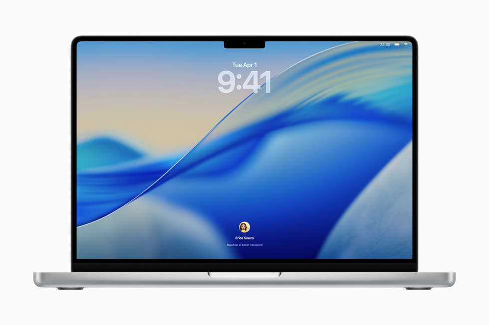
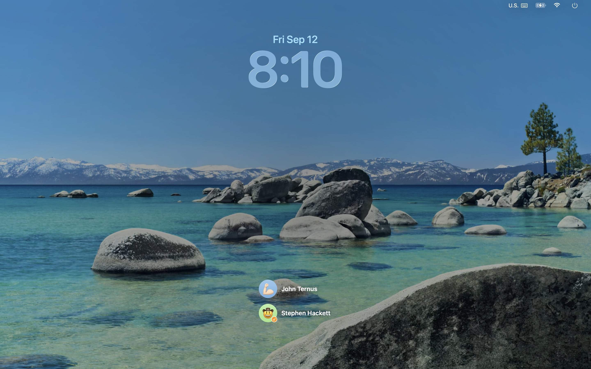

# 参考图、来源与使用边界

## macOS Tahoe 26

[Apple 官方报道](https://www.apple.com/newsroom/2025/06/macos-tahoe-26-makes-the-mac-more-capable-productive-and-intelligent-than-ever/) 中的图是 Lock Screen 宣传图，有设备外框。适合研究留白、壁纸、时钟和单用户区域，不是冷启动登录全状态证据。

[512 Pixels 截图库](https://512pixels.net/projects/aqua-screenshot-library/macos-26-tahoe/) 标记 Login Window；[原图](https://media.512pixels.net/downloads/macos-screenshots/26/26-Tahoe-Fast-User-Lockscreen.png) 文件名包含 Fast-User-Lockscreen。适合观察多用户纵向头像/名字布局，但不能直接当冷启动统一规范。

远程图为来源方版权资料，仅作研究引用；不得直接装入产品分发。下载结果见 [素材状态](assets/STATUS.md)。若远程不可达，不得以概念图假冒实机截图。

## 用户当前配置

截图确认“由 KOS 显示壁纸”开启、图片类型、填满屏幕、从上滑入。此截图是用户提供的设置状态，不是登录实现预览。

## 视觉提炼与缺口

- 上方日期与大时钟，下面较低位置的用户区，中部大量留白。
- 多用户参考中圆头像加右侧名字采用纵向列表；单用户使用头像、名字上下结构。
- 背景主导画面，表单不包在大块深色磨砂卡片里。
- 时钟字形、字重、边缘高光、透明度与背景关系都需单独测量。
- 密码展开、失败、等待、菜单、登录成功的精确参数没有充分实机参考，列为 T04 交付，不能自行宣称 1:1。

## 本包概念视觉

[分镜](assets/storyboard.html) 与 [交接图](assets/handoff.svg) 均为架构/布局示意。它们不使用 Apple 系统字体、未重现原版玻璃 shader，不能作为像素级验收基准。

## T04 研究交付

见 [基准报告](evidence/T04/REPORT.md)、[来源配置与版权](evidence/T04/SOURCES.md)、[状态缺口和补采计划](evidence/T04/GAPS.md)。静态标注与测量只适用于两张研究样本，精确构建/字体配置未知，动画未测，不能声明完整1:1。
