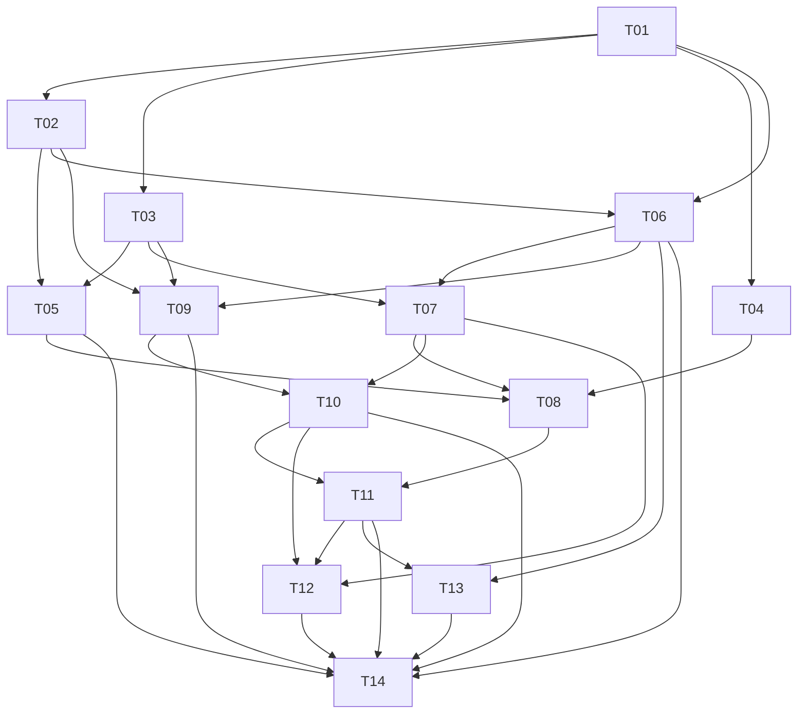

# 独立任务卡索引

每张卡可独立派发；状态初始均为待开始。依赖表示验收交付，而不是仅文件存在。

| 卡片 | 任务 | 依赖 | 状态 |
|---|---|---|---|
| [T01](T01.md) | 事实与环境核验 | 无 | 完成 |
| [T02](T02.md) | 最小登录生命周期原型 | T01 | 完成（用户明确要求关闭，2026-10-11） |
| [T03](T03.md) | 展示资源发布与权限 | T01 | 完成（隔离发布侧） |
| [T04](T04.md) | Tahoe视觉基准采集 | T01 | 完成（A15-R 研究交付） |
| [T05](T05.md) | 身份与认证界面 | T02,T03 | 完成（用户确认已验收，2026-10-11） |
| [T06](T06.md) | 显示输出同步与安全回退 | T01,T02 | 完成（用户验收确认，2026-10-11） |
| [T07](T07.md) | 独立壁纸宿主 | T03,T06 | 完成（隔离宿主验收） |
| [T08](T08.md) | 登录视觉与退场 | T04,T05,T07 | 阻断（实现/隔离验证已交付；完整A15缺实机基准） |
| [T09](T09.md) | 会话wrapper与交接描述 | T02,T03,T06 | 完成（实现/隔离验证及独立复审通过，2026-10-12） |
| [T10](T10.md) | 早期桌面Cover | T07,T09 | 完成（实现/隔离 A09/A14-C 及独立复审通过，2026-10-12） |
| [T11](T11.md) | 桌面就绪门控与揭幕 | T08,T10 | 阻断（实现/隔离验证已交付；完整 A03/A10 与冷热启动录像未测，独立复审通过） |
| [T12](T12.md) | 动态与空间壁纸回退 | T07,T10,T11 | 阻断（静态回退实现/隔离验证；独立复审通过，完整依赖/实机未测） |
| [T13](T13.md) | 交接性能与黑帧测量 | T06,T11 | 阻断（测量准备实现/验证及独立审查通过；完整 A16/实机录像及 T11 依赖未测） |
| [T14](T14.md) | 故障矩阵与集成评审 | T05,T06,T09,T10,T11,T12,T13 | 阻断（隔离故障矩阵/集成评审及独立审查通过；完整依赖与实机验收缺证据） |

用户于2026-10-11明确确认T01–T05全部验收完成；本页据此更新依赖状态。原证据记录保留为历史执行快照，不代表用户后续验收未完成，也不补写未提供的录像或测量。

## 依赖图

优先顺序：T01事实 → T02生命周期门槛 → T03/T04/T06 → T05/T07 → T08/T09/T10 → T11 → T12/T13 → T14集成评审。T04参考采集可以与资源研究并行，不必阻塞最小安全原型。

## 关闭任务的必要条件

每张卡完成后必须调用未参与该卡编写或实现的独立子代理审查；发现问题由执行者修复并独立复审。状态与记录要求见 [独立审查规则](../REVIEW_POLICY.md)。任务状态以本页表格为准；文档审查不等于实现完成。

状态裁定：用户于2026-10-11明确要求 T02 强制标记完成，并确认 T06 验收完成。T01–T06 均已关闭；历史缺测记录仅用于追溯，不作为重新打开任务或阻断后续任务的依据。未提供的测量数据不补造。
