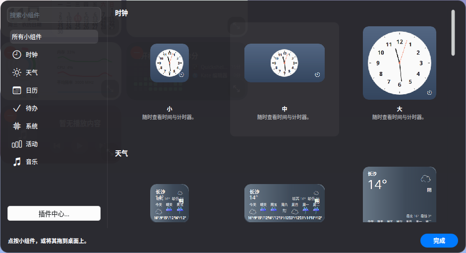
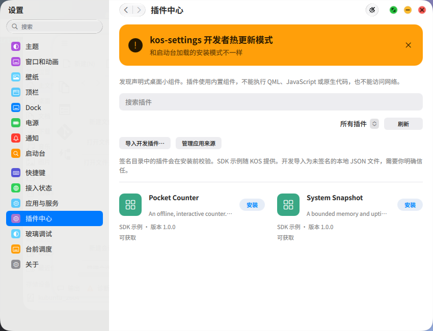
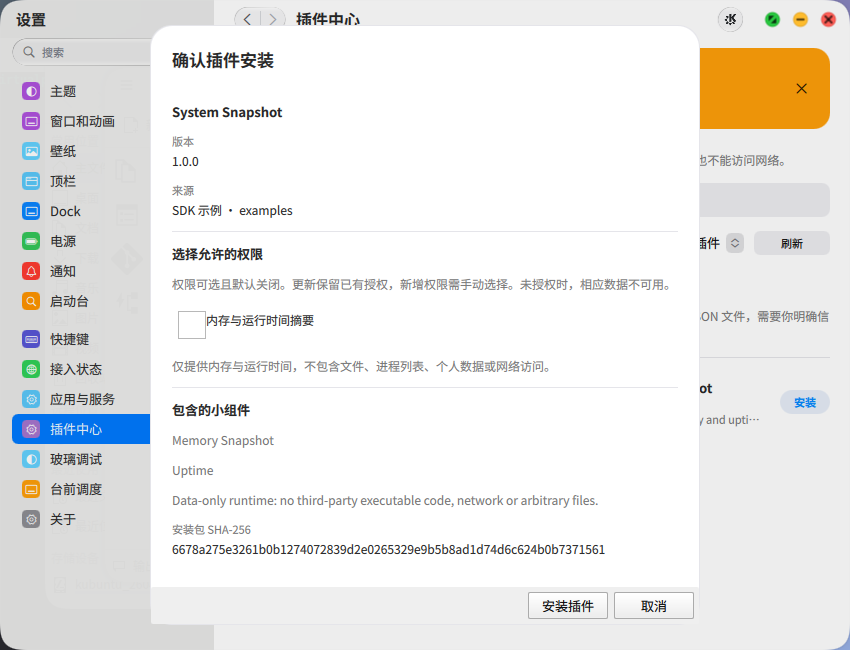
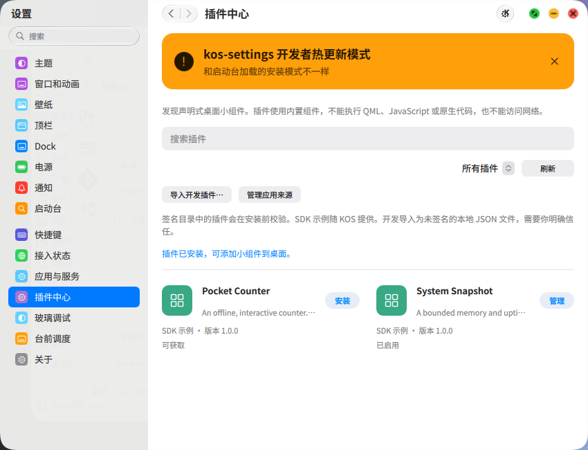

# 桌面小组件与插件中心：第一阶段交付

关联任务：[NextKde/NextKde#363](https://github.com/NextKde/NextKde/issues/363)。交互依据：[Apple「在 Mac 上添加和自定义小组件」](https://support.apple.com/zh-cn/guide/mac-help/mchl52be5da5/mac)。

本阶段把桌面组件库、设置中的插件中心和受限声明式插件接起来。第三方提交 JSON 清单，宿主负责绘制和执行固定动作；不加载第三方 QML、JavaScript 或原生代码。#363 保持开放，完整可执行插件沙箱及后续能力不在本阶段完成范围内。

## 已实现

- 桌面编辑入口、分类与搜索、小中大预览、点击或拖入添加、减号移除、右键尺寸与配置；第三方组件区分类型和实例，可支持多个独立实例。
- 设置侧插件中心：搜索与来源过滤、SDK 示例、本地开发导入、安装计划、权限选择、启用/禁用、权限撤销及保留/删除配置的卸载。
- 受限视图支持文本、值、行列和固定动作按钮；仅开放显式授权的 `system.summary`（内存与运行时间摘要），不开放网络、任意文件、个人日历、任意 IPC 或可执行代码。
- 复用已有签名目录体系；安装计划绑定来源、版本、摘要、会话与状态修订。开发文件需单独确认未签名信任，不能借此获得额外能力。
- [开发说明](SDK.md)、[协议及限制](Protocol.md)和两个可安装的示例包。

## 实机效果图

以下图片来自实际桌面会话，仅裁剪窗口或组件库区域；不是设计稿，也未做像素比较或自动化断言。插件中心的示例安装使用临时独立数据、配置、缓存目录和私有 session bus；截图中的开发模式横幅如实保留。截图中未提供真实账号或用户数据。

### 桌面组件库

第二轮部署后的画面：左侧分类与搜索、右侧尺寸预览、底部提示与完成。天气预览仍可见挤压；本分支最后追加的正常逻辑尺寸渲染后整体缩放修复尚未部署拍图，不能把这张图当作该修复的验证。与 Apple 原图的配色、字体、图标及面板占屏比例仍有差异。

### 插件中心

两个 SDK 示例通过正常发现入口显示。此隔离会话没有导入用户的远程目录配置，不代表已验证签名远程市场安装。原桌面会话存在目录签名错误，界面如实显示错误，没有绕过签名检查。

### 安装权限确认

系统摘要权限默认关闭，安装前展示来源、版本、请求权限及包摘要。此截图中的安装随后在未勾选权限的情况下完成。

### 安装后的管理入口

安装成功后示例变为管理入口；安装与添加桌面实例是两个独立操作。尚未取得第三方实例实际渲染截图，不宣称完整实例交互验收完成。

## 验证记录与限制

- 已完成本地 C++ 构建；第二轮代码在测试环境完成构建、安装及重新登录，并读取实际截图和启动日志。
- 第二轮确认新增界面的 `ThemeService` 引用错误已消失，组件库底色改善了无背景模糊协议环境中的可读性。
- 通过界面展示安装计划，并在隔离存储中安装了未授予系统摘要权限的 SDK 示例。
- 未编写或运行自动化测试。截图只提供人工观察证据。
- 最后两处 QML 预览缩放改动未部署观察：第三轮同步/构建/安装/重新登录被自动审批拦截，未绕过该限制。它们不包含新的 C++ 改动。
- 尚待人工验收：拖入定位、多个实例、配置与按钮动作、尺寸碰撞、权限撤销后清空受限值、重登录持久化、禁用恢复和卸载保留/删除的完整回路。操作清单见 [SDK 手工验收](SDK.md#manual-acceptance)。
- 深色、窄窗、空状态、hover 等没有对应 Apple 参考图；当前按宿主约定实现，未宣称参考矩阵全部收敛。动画也未通过静态图验证。

## 后续范围

可执行插件的进程沙箱与资源预算、更广的数据能力、历史版本回滚界面、独立恢复入口、真实第三方签名目录发布与安装，以及完整交互人工验收仍需后续迭代。当前平台 socket 信任同一桌面用户的宿主客户端，JSON 插件本身不获得 socket 或宿主对象；这不是针对同用户恶意原生程序的隔离边界。
