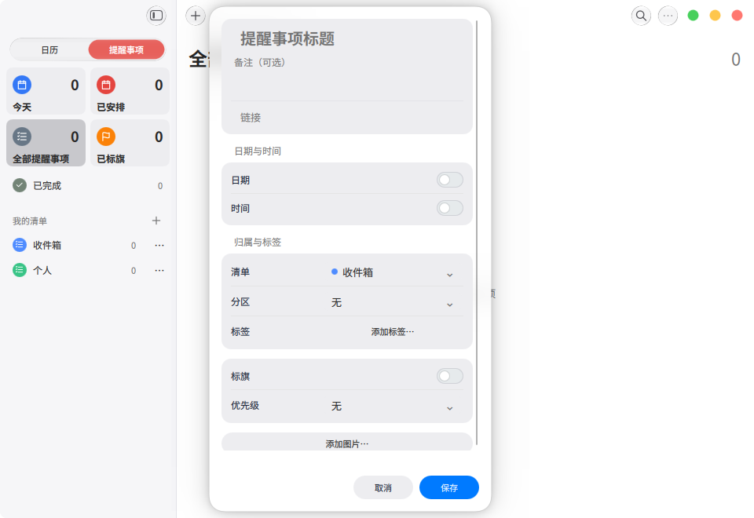
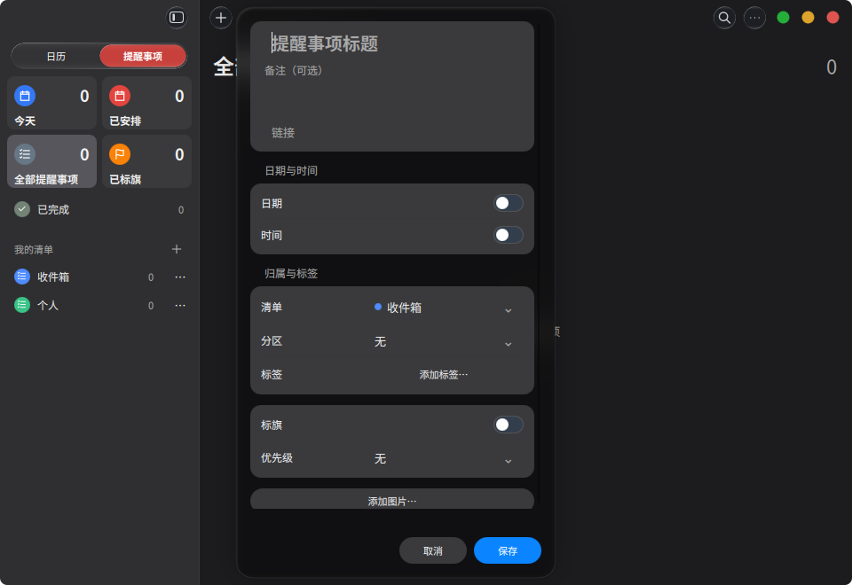
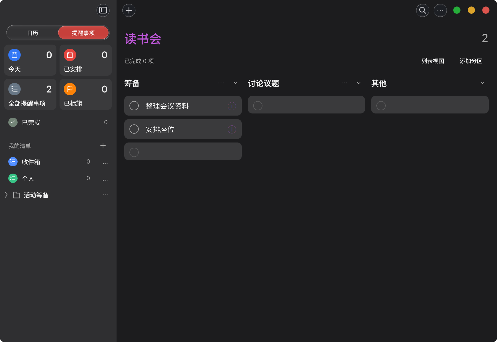
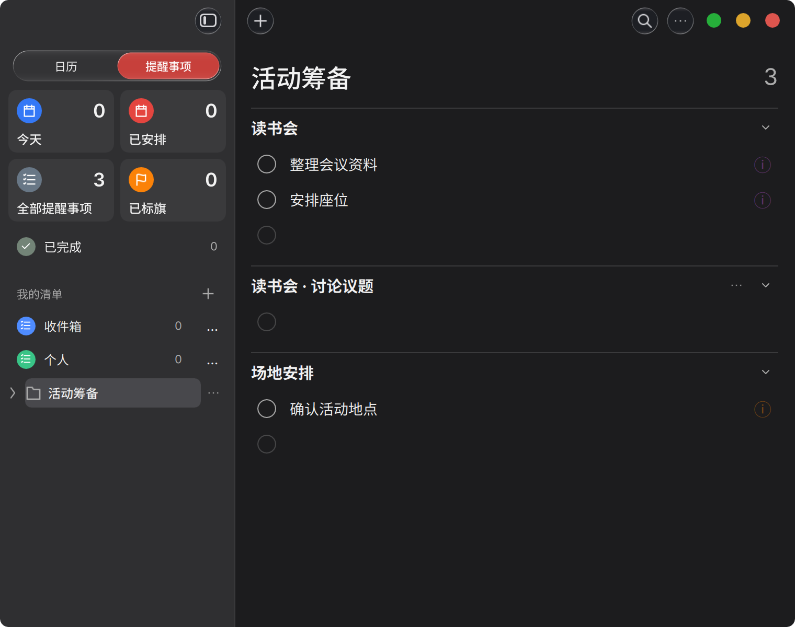
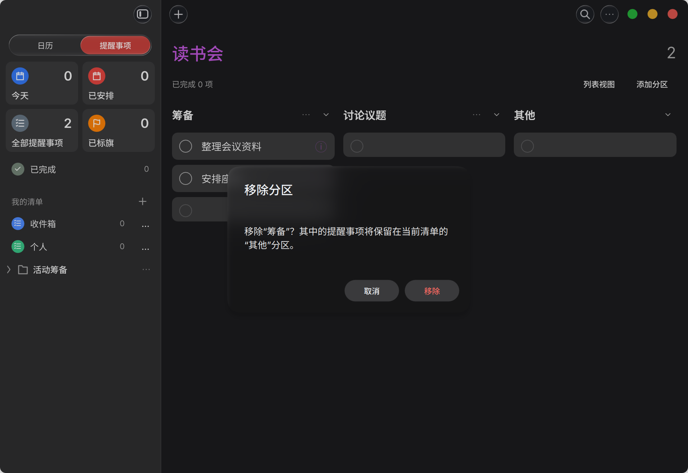

# 日历／提醒事项远程验收 · 2026-10-29

## 最新截图：Popover 箭头修正后

以下 5 张为本次更新后重新编译的日历截图，取代下方旧图作为 Popover 箭头验收依据。
采集环境：Kubuntu 虚拟机、Qt 6.11.2、独立 KWin Wayland 虚拟输出，
OpenGL／Mesa llvmpipe 渲染；窗口为 960 × 660，使用隔离的空白 PIM 数据。
截图来自实际应用窗口内容，未使用设计稿或后期合成。虚拟机的字体和图形驱动
可能与日常桌面不同，因此本页主要验收面板轮廓、箭头位置和布局。

### 日程表单：无箭头

### 待办表单：浅色与深色，无箭头

### 侧栏小菜单：保留对准按钮的箭头

### 靠右窗口边缘的菜单：位置受限后仍准确指向按钮

采集脚本：`apps/calendar/tests/PopoverScreenshots.qml.inc`，配合
`run-popover-review.py` 的 `KOS_CALENDAR_REVIEW_FIXTURE` 参数运行。
本次编译成功，截图流程退出码 0，输出 `REMINDER_ORGANIZATION_TESTS_PASSED`；
已逐张查看。高表单无箭头、两种菜单箭头对准触发按钮。

---

## 之前的功能验收记录

本分支将提醒事项整合进日历，并补齐群组、清单、分区和行内编辑。界面沿用 nextkdeAppDemo 通用组件。截图来自实际运行窗口，使用隔离的临时样例数据，不包含用户日历数据；不是设计稿。

## 验收路径

1. 切换到提醒事项，在左侧创建群组及清单。点击群组名称查看成员清单汇总；点击箭头仅折叠导航。
2. 选中一个清单，在内容空白处右键添加分区。分区支持重命名、排序、折叠和删除；删除分区保留其中待办。
3. 点击分区末尾空白行输入待办，Enter 保存并继续添加，Esc 取消。空白内容不保存。已有条目可以直接编辑标题。
4. 点击条目信息按钮打开详情 Popover，设置日期、时间、标签、URL、优先级及图片。编辑已有待办不显示日程／待办切换。
5. 切换列表／分栏视图，检查浅色、深色和窄窗口。群组汇总按所属清单展示，分栏中的列是同一清单的分区。

## 浅色分栏

常规窗口按 960 × 660 逻辑尺寸验收；截图采用屏幕实际像素倍率。

## 待办详情

外层使用通用浮动面板，内部使用普通表单控件及统一设置分组。

## 群组汇总

## 深色分栏

## 窄窗口

760 × 600 逻辑尺寸；检查群组中多个清单的汇总及滚动。

## 删除分区确认

确认中说明保留待办，避免把删除分区误解成删除内容。

## 已完成的验证

- 日历、PIM 服务及存储测试目标编译通过。
- PIM 存储、服务 D-Bus、客户端 D-Bus 三组测试通过。
- 四组图形交互回归通过：日历范围选择与 Popover、提醒事项组织与拖动、详情与附件、群组／分区／行内创建及分栏。
- 最新截图对应的层级交互回归退出码为 0，输出 `REMINDER_ORGANIZATION_TESTS_PASSED`。
- 检查了浅色、深色、窄窗口和删除确认截图；验证日志中有隔离会话的桌面 Portal 注册提示，未发现 QML 加载错误或绑定循环。

本页截图供远程视觉验收；交互路径供后续实际操作复核。分支尚未合入 main。

## 箭头修正（后续提交）

新建／编辑日程和待办的大表单隐藏箭头，保留浮动面板的液态材质、高光与阴影。
小 Popover 保留箭头，但在贴边后无法准确指向来源或来源移出窗口时自动隐藏。
通用组件补齐向上、向左的优先方向处理。

虚拟机 Qt 6.11.2 的独立定位回归通过（5 passed，0 failed，含初始化／清理）：
四个方向、角落／移出窗口、大表单无箭头及其 padding。
复现：在虚拟机运行 `python3 apps/calendar/tests/run-popover-arrows.py`。
该轮为 offscreen 定位验证；后续已补充本页顶部的虚拟机 Wayland 实际应用截图。
历史功能截图保留用于对照，箭头效果以顶部最新截图为准。
